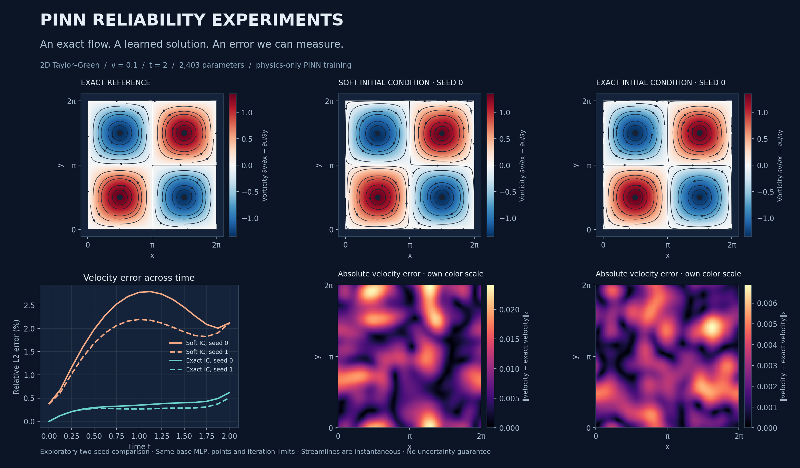

# PINN reliability experiments

**How accurate is a physics-informed neural network—and which signals reveal its errors?**

A small, reproducible lab for investigating that question with the exact **2D Taylor–Green vortex** solution of incompressible Navier–Stokes. Start with a known answer, measure the mistakes, then test improvements one at a time.



*Figure generated from the committed checkpoints, not a browser screenshot. Top: vorticity at t = 2, with a shared color scale. Bottom: relative velocity error across time and absolute vector-error maps with separately labelled scales. Lines distinguish the two seeds; they are not confidence intervals.*

## What is here

- A readable PyTorch PINN with automatic differentiation of the momentum and continuity equations.
- A matched comparison of **soft versus exactly enforced initial velocity**.
- Saved checkpoints, scalar histories and raw evaluation metrics for all five runs.
- An interactive, locally generated browser explorer with vorticity, streamlines and error maps.
- An initial **uncalibrated** ensemble-disagreement diagnostic and an annotated reading path.

This is an exploratory research and learning repository. It does **not** introduce a new PINN method, certify solutions, demonstrate calibrated uncertainty, or establish performance on turbulent flows.

## First result: enforce the known initial state exactly

| Seed | Soft IC: velocity error | Exact IC: velocity error | Soft IC: pressure error | Exact IC: pressure error |
|---|---:|---:|---:|---:|
| 0 | 2.098% | **0.334%** | 6.406% | **2.143%** |
| 1 | 1.729% | **0.268%** | 5.753% | **1.923%** |

Values are final Adam + L-BFGS checkpoint errors, measured over the same 32 × 32 spatial grid at 17 times. Velocity error is the joint relative L2 error of both components. Pressure is centered independently at each time. A 64 × 64 spatial evaluation gives the same displayed values. This checks spatial evaluation sensitivity, not full numerical convergence.

The two formulations share the same base MLP initialization, 2,403 trainable parameters, training coordinates and optimizer iteration limits. Exact-IC changes the trial function and its optimization geometry. The comparison is **not matched by wall-clock time**, and two seeds do not establish general robustness. [Full protocol and limitations →](BASELINE_IMPROVEMENTS.md)

## Quick start

Use Python 3.13 and [uv](https://docs.astral.sh/uv/). No GPU is required. The direct dependencies are pinned to those used for the saved runs; `uv.lock` fixes the resolved environment.

```bash
git clone https://github.com/ThoreKoritzius/pinn-reliability-experiments.git
cd pinn-reliability-experiments
uv sync --frozen

# Check the equations, constraints and saved checkpoint metrics.
uv run python -m unittest discover -s tests -v

# Build an offline explorer from the committed checkpoints.
uv run python export_explorer.py --standalone --out demo.html
```

Open `demo.html` in your browser. Select **Vorticity + streamlines**, then compare **Soft IC** and **Exact IC**. The default build evaluates a 96 × 96 grid at 33 times; vorticity comes from autograd. The HTML is approximately 32 MB, requires no server for its core features, and is generated rather than committed. Streamlines depict instantaneous velocity fields, not particle trajectories.

For a smaller demo:

```bash
uv run python export_explorer.py --standalone --resolution 32 --frames 9 --out demo.html
```

## Reproduce the training

The committed `results/` folders are the reference snapshot. Reproduce all five runs in a separate directory so the reference is preserved:

```bash
uv run python reproduce.py --root reproduced
```

Or run one experiment:

```bash
uv run python taylor_green.py --seed 0 --out reproduced/soft_seed0
uv run python taylor_green.py --hard-ic --seed 0 --out reproduced/exact_seed0
```

The script uses CPU float64 and one CPU thread by default. Identical seeds do not promise bitwise-identical retraining across hardware or software versions. Tests verify the saved checkpoint metrics; they do not assert that fresh optimization must reproduce every digit.

```bash
# Rebuild reference plots and the result table from saved checkpoints.
uv run python summarize.py
uv run python make_readme_figure.py

# Initial two-member uncertainty diagnostic (not calibrated intervals).
uv run python uncertainty_probe.py
```

Node.js 22+ is needed only for the optional explorer logic checks:

```bash
node validate_explorer.cjs results/explorer-data.html
node validate_standalone.cjs
```

These are data/control smoke tests, not browser layout or accessibility certification. GitHub Actions runs them on a small generated explorer together with the mathematical and checkpoint checks.

## The mathematical problem

With density one, no forcing, ν = 0.1 and periodic coordinates (x, y) ∈ [0, 2π)², we approximate the flow over t ∈ [0, 2]:

```text
u_t + u u_x + v u_y + p_x − ν(u_xx + u_yy) = 0
v_t + u v_x + v v_y + p_y − ν(v_xx + v_yy) = 0
u_x + v_y = 0
```

An exact solution is:

```text
a(t) = exp(−2νt)
u =  sin(x) cos(y) a(t)
v = −cos(x) sin(y) a(t)
p = ¼ [cos(2x) + cos(2y) − 2] a(t)²
```

The pressure convention fixes p(0, 0, t) = 0. Other time-dependent additive offsets describe the same velocity solution. Our error metric removes the spatial pressure mean at each time.

The periodic MLP takes `(sin x, cos x, sin y, cos y, 2t/T − 1)` and has three tanh hidden layers of width 32. The soft-IC loss is:

```text
mean(momentum residual²) + mean(divergence²)
+ 10 × mean(initial velocity error²) + mean(pressure gauge error²)
```

For exact IC, the velocity output is `u_initial + (t/T) × network_velocity`; its initial error is identically zero. Pressure remains independently learned. This uses known initial data, not exact future values.

Training uses 1,024 fixed scrambled Sobol interior points, 256 initial points, 64 pressure-gauge points, 2,000 Adam steps and at most 300 L-BFGS iterations. Residual auditing uses an independent 2,048-point Sobol scramble. Neither the exact future field nor audit/evaluation values enter parameter updates or checkpoint selection. The supervised diagnostic explicitly uses exact interior labels and is a separate, unequal-information control.

## Scientific scope

- **Verification, not physical validation:** the reference is an analytical PDE solution, not an experiment.
- **One smooth flow family:** 2D Taylor–Green has pressure–advection cancellation and no nonlinear transfer between excited modes. Lower viscosity alone does not make this benchmark turbulent.
- **Development evidence:** these diagnostics guided subsequent choices. They are not a pristine held-out research test set.
- **Residual is not error:** residuals involve derivatives; solution error also depends on initial/boundary conditions, sampling and PDE stability. Zero flow solves the differential equations but violates our requested initial state.
- **Disagreement is not calibrated uncertainty:** the current two-member spread bands have no coverage guarantee. Random-seed variation can miss shared bias. [Uncertainty notes →](UNCERTAINTY.md)

## Read and explore

| Resource | Purpose |
|---|---|
| [Reading list](READING_LIST.md) | Foundational PINNs, training failures, error analysis and calibration |
| [Taylor–Green guide](TAYLOR_GREEN.md) | Derive the solution and interpret the diagnostics |
| [Baseline comparison](BASELINE_IMPROVEMENTS.md) | Exact-IC intervention and matched experimental choices |
| [All recorded results](RESULTS.md) | Adam and L-BFGS metrics for every saved run |
| [Artifact provenance](docs/ARTIFACTS.md) | Reference snapshot, environments and checksums |
| [Contributing](CONTRIBUTING.md) | How to propose a controlled experiment |

The next experiment is fixed versus resampled collocation with exact initial conditions, holding other choices fixed. Later work can examine calibration and transfer across whole problem configurations.

## References and license

This implementation follows the general PINN formulation of [Raissi et al. (2019)](https://doi.org/10.1016/j.jcp.2018.10.045). The interpretation of training and solution errors is informed by [De Ryck, Jagtap & Mishra](https://arxiv.org/abs/2203.09346) and [Wang et al.](https://arxiv.org/abs/2308.08468). These references do not endorse this implementation or its results.

[MIT license](LICENSE). Figures, checkpoints and numerical outputs in this repository are generated by this project. Third-party papers and plugin runtimes are not redistributed.
